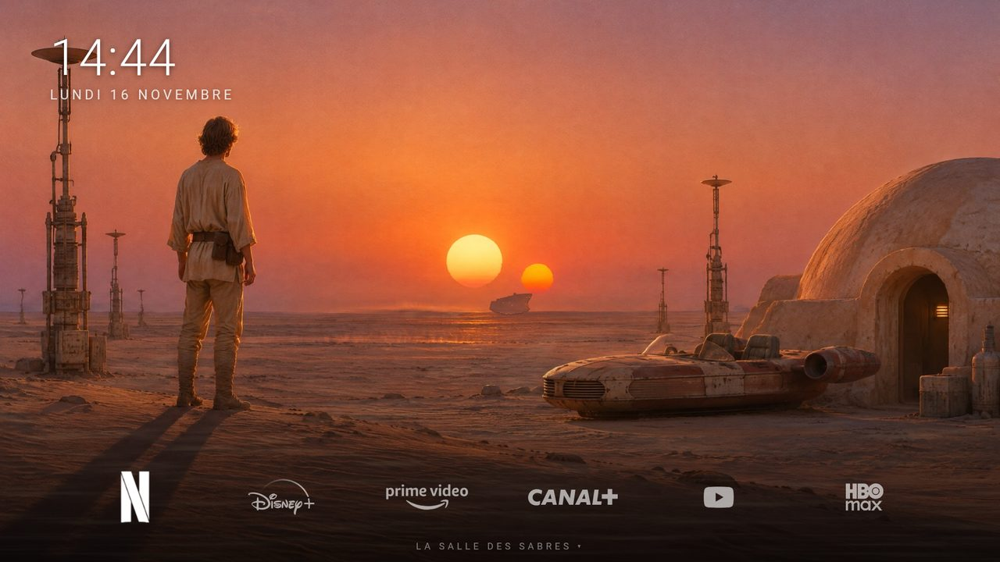
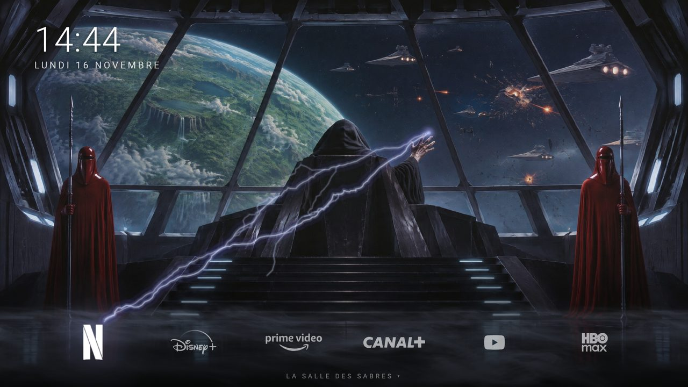
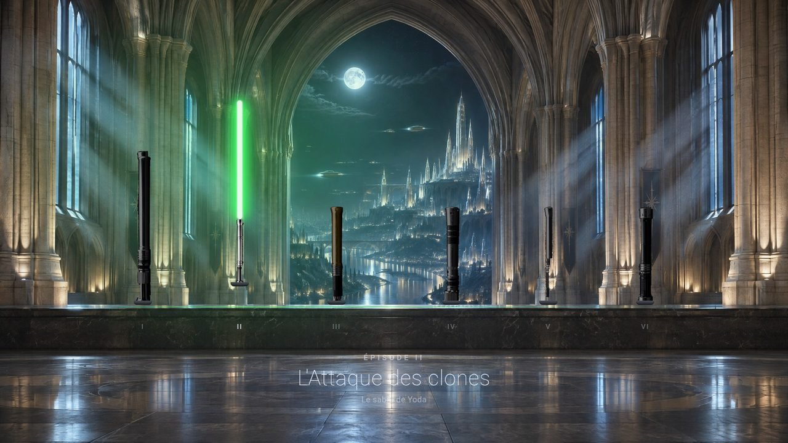
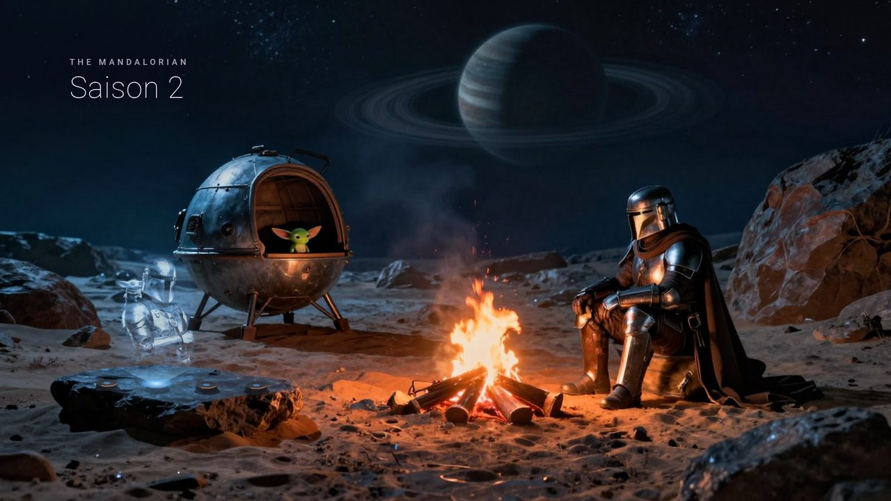
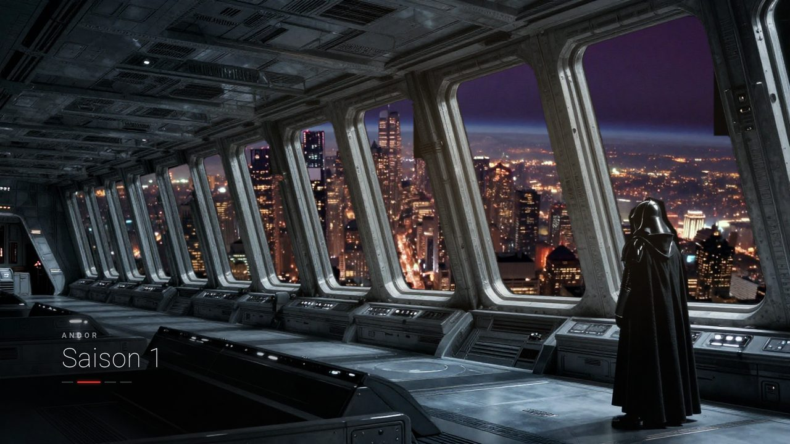

# Star Wars TV

> **En français, pour débutants :** [installer Star Wars TV sur ta télé](INSTALLER.md) · [guide pour l'assistant IA](docs/POUR-CLAUDE.md).
> L'appli prête à installer est sur la [page des versions](https://github.com/Wavia-tech/star-wars-tv/releases/latest).

Un écran d'accueil Star Wars pour les télés Android TV et Google TV. Projet de fan, gratuit, non officiel, de la même
famille que [Poudlard TV](https://github.com/Wavia-tech/poudlard-tv).

- **L'accueil change selon ton côté de la Force.** Côté lumineux : le coucher des deux soleils sur Tatooine, la chaleur
  qui fait trembler l'horizon, le sable qui court au sol, un sandcrawler qui passe au loin. Côté obscur : la salle du
  trône de l'Empereur, la brume au sol, et ses éclairs qui frappent l'appli choisie.
- **Tes applis** en bas (Netflix, Disney+, Prime Video…), celles que tu choisis parmi celles de ta télé.
- **↓ La salle des sabres** : un sabre laser par épisode, qui s'élève et s'allume dans sa couleur.
- **↓ Le camp du Mandalorien** : les quatre palets de prime, chacun projette son hologramme (saisons 1 à 3, le film).
- **↓ La passerelle de Vador** : derrière les vitres, Mustafar, Coruscant, l'Étoile de la Mort en chantier, Scarif.
  En choisir un autre fait un saut en hyperespace.
- **Réglages** en haut à droite : côté de la Force, applis et films, touche Home (et retour à l'accueil d'origine),
  sons, réglages de la télé.

| | |
|---|---|
|  |  |
|  |  |

Aucune permission demandée à la télé, aucune connexion, aucune donnée collectée. Tout est réversible : Réglages →
Touche Home → Accueil d'origine, ou désinstaller l'appli.

## Pour les développeurs

- `app/` : la page (une seule `index.html` + `ours/` pour l'accueil animé). Aperçu dans un navigateur :
  `node tools/serve.mjs app 8770`, puis http://localhost:8770 (touches : flèches, Entrée, Échap ; C change de côté).
- `android/` : le lanceur Android, sans Gradle ni bibliothèque (`bash android/build.sh`, voir `android/README.md`).
- `tools/` : les outils des images (`gen-sections.ps1`, `sections.py`, …) et `tv-eval.mjs` pour mesurer sur une télé.

Mesuré sur une télé d'entrée de gamme (puce Mali-470) : les accueils à 60 images/s, les autres pages entre 51 et 63.

## Licence et crédits

Le code est sous licence MIT ; une partie de la page reprend un code MIT dont la licence est dans `app/LICENSE-kevin.txt`.
Les images des décors ont été créées pour ce projet avec un générateur d'images local. Les logos des applis
appartiennent à leurs propriétaires et ne servent qu'à les reconnaître.

Star Wars et les noms associés sont des marques de Lucasfilm Ltd. Ce projet de fan, gratuit et non commercial, n'est ni
affilié à Lucasfilm ni à Disney, ni approuvé par eux.
